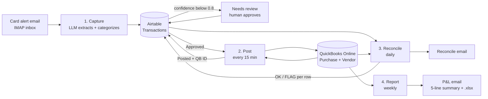

# AI Bookkeeper

Four n8n workflows that take a company-card expense from a bank alert email all the way to QuickBooks Online, check the books every day and send a weekly Profit and Loss summary with an Excel file.

Built and tested against an Intuit QuickBooks Online **sandbox** company with **synthetic** card alerts. No real financial data.

## What each workflow does

| # | Workflow | Trigger | What it does |
|---|---|---|---|
| 1 | Capture | New unread email (IMAP) | Reads the card alert, skips emails already in Airtable, has an LLM return structured JSON (date, vendor, amount, currency, card last 4, QuickBooks expense account, confidence, reason), saves a row. Confidence 0.8+ is `Approved`, below is `Needs review`. |
| 2 | Post | Every 15 minutes | Takes `Approved` rows with no QuickBooks ID, matches the category to a QuickBooks account, finds or creates the vendor, creates a credit card Purchase, writes the Purchase ID back and sets `Posted`. Any failure sends the row back to `Needs review`. |
| 3 | Reconcile | Daily, 9 AM | Compares every Airtable row with QuickBooks purchases. Writes `OK` or `FLAG: reason` on each row and emails a report with totals. |
| 4 | Report | Monday, 9 AM | Pulls the QuickBooks Profit and Loss report for the last 7 days, has the LLM write a 5-line plain-English summary, emails it with the report as an .xlsx file. |

## Design choices

- **Human in the loop.** Low-confidence extractions never reach QuickBooks on their own. A person changes the row to `Approved` and workflow 2 posts it on the next run.
- **Constrained output.** The LLM must pick the category from a fixed list of the company's QuickBooks expense accounts (a JSON schema enum), so it can't invent an account. Temperature 0 for extraction.
- **The email is treated as data.** The prompt tells the model to ignore instructions inside the email. The trigger also only reads mail from one sender with "Transaction alert" in the subject.
- **Idempotent capture.** The email's Message-ID is stored, and emails already in Airtable are dropped before the LLM is called.
- **Accounts matched by full name.** QuickBooks can have two accounts with the same name under different parents (the sandbox has "Equipment Rental" twice), so matching uses `FullyQualifiedName`.
- **One join key across systems.** Each QuickBooks Purchase gets the Airtable record ID as its Ref No. (`DocNumber`). Reconcile uses it to find duplicates and posts that never got their QuickBooks ID written back.
- **Rows are posted one at a time** so a new vendor is created once, not once per expense.
- **Swappable model.** The LLM sits in one chat-model node. It runs on Groq `gpt-oss-120b` (free tier). Switching to Claude means swapping that one node.

## What reconcile checks

- Posted row whose QuickBooks purchase no longer exists (for example, deleted)
- Amount mismatch and date mismatch between Airtable and QuickBooks
- Two or more QuickBooks purchases with the same Ref No. (double post)
- Duplicate Email ID or QuickBooks ID in Airtable
- Purchase exists in QuickBooks but the Airtable row has no QuickBooks ID
- QuickBooks purchase with an AI Bookkeeper Ref No. but no Airtable row
- Totals: Airtable posted vs QuickBooks, plus the difference

## Tested (sandbox, November 2026)

| Test | Result |
|---|---|
| 3 synthetic alerts | Adobe $54.99 (Dues & Subscriptions, 0.93) and Capital Grille $86.40 (Meals and Entertainment, 0.97) approved; Amazon Marketplace $127.43 (Supplies, 0.75) sent to review |
| Duplicate email | 0 new rows |
| Posting | Purchases created in the QuickBooks Visa register with the right payee, account, memo and Ref No. |
| Human approval | Amazon approved by hand, posted on the next run |
| Reconcile, clean | 4 rows OK, Airtable $287.82 = QuickBooks $287.82 |
| Reconcile, tampered | Slack changed to $21.00 in QuickBooks: flagged "Amount mismatch: Airtable $19.00 vs QuickBooks $21.00" |
| Weekly report | Income $500.00, expenses $321.82, net income $178.18; the summary matched the report numbers |

## Stack

n8n (self-hosted) · QuickBooks Online API v3 (OAuth2, HTTP Request nodes) · Airtable · Groq `gpt-oss-120b` · IMAP + SMTP · n8n Convert to File (.xlsx)

## Setup

1. Create an Intuit developer app and a sandbox company. In n8n, add these credentials: QuickBooks OAuth2 (sandbox), Airtable personal access token, IMAP, SMTP, Groq.
2. In Airtable, create a table `Transactions` with these fields: Email ID, Date (date), Vendor, Amount (currency), Currency, Card Last4, Category, Confidence (number, 2 decimals), Status (single select: Needs review / Approved / Posted), QB Purchase ID, Recon Check.
3. Import the 4 files from `workflows/`. On every node with a credential, select it again (exported JSON doesn't carry credentials). Pick the base and table on each Airtable node.
4. Replace the placeholders: `PASTE_TEST_SENDER_EMAIL` (capture trigger), `PASTE_SANDBOX_COMPANY_ID`, `PASTE_REPORT_TO_EMAIL`, `PASTE_SMTP_FROM_EMAIL` (Config nodes).
5. Check the category list in the Capture schema against your Chart of Accounts, then activate the workflows and send the alerts in `test-emails.md`.

Note: an active IMAP trigger only fetches mail newer than the last one it saw, so marking an old email unread will not re-run it.

## Limits

- USD only. Non-USD rows go to review.
- Every expense posts to one credit card account (`Visa` in Config). A card-number-to-account map would handle several cards.
- If the QuickBooks post succeeds but the Airtable write-back fails, the next run can post it again. Reconcile catches this as a duplicate Ref No.
- Built for a sandbox. For production: switch the base URL, add error alerts, and handle QuickBooks token refresh failures.
